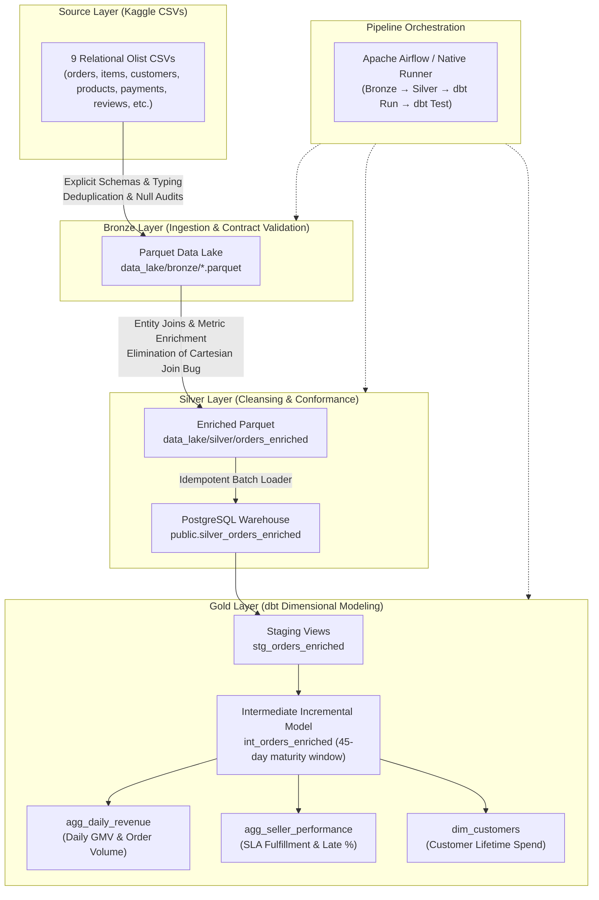

# DataStack — E-Commerce Data Engineering Platform

[]()
[](https://www.python.org/)
[](https://spark.apache.org/)
[](https://www.getdbt.com/)
[](https://www.postgresql.org/)
[](LICENSE)

An end-to-end data engineering pipeline built with **PySpark**, **PostgreSQL**, **dbt**, and **Apache Airflow** using the Brazilian Olist e-commerce dataset (100k+ real commercial orders across 9 relational tables).

DataStack enforces deterministic data contracts, executes cross-domain entity resolution, persists curated analytical layers in a PostgreSQL data warehouse, transforms business metrics using **dbt**, and orchestrates workflows with **Apache Airflow**.

---

## 🏛️ Medallion Architecture

DataStack implements a multi-layer Medallion Lakehouse & Warehouse architecture:



---

## 🛠️ Technology Stack

| Component | Technology | Version | Engineering Role |
|---|---|---|---|
| **Data Processing Engine** | Apache Spark (PySpark) / DuckDB | 3.5.1 / 1.x | Scalable batch ETL, explicit schema casting, Parquet writing |
| **Data Warehouse** | PostgreSQL | 15+ | Relational OLAP warehouse for silver line items and gold marts |
| **Transformation Framework** | dbt-core & dbt-postgres | 1.11 | SQL modeling, incremental processing, documentation, schema contracts |
| **Pipeline Orchestrator** | Apache Airflow | 2.10+ | DAG dependency management, retries, idempotent execution |
| **Language & Environment** | Python & Conda / Temurin JDK | 3.12 / Java 11 | Strong typing, reproducible environment, cross-platform portability |
| **Infrastructure** | Docker & Docker Compose | Latest | Local containerized warehouse with health checks and volume persistence |

---

## 🔍 Key Engineering Improvements

- **Revenue Correctness & Financial Reconciliation:** Fixed join-cardinality issues that could multiply order revenue when combining one-to-many child datasets (`order_items` and `order_payments`). Payments are pre-aggregated to the order grain, preserving exact line item price, freight, and order totals.
- **Explicit Schema Enforcement:** Replaced fragile runtime schema inference with strictly typed schemas for all 9 source datasets to prevent type drift and handle malformed records deterministically.
- **Delivery-Delay Validation:** Implemented robust SLA logic that distinguishes valid early deliveries (negative delay days) from true shipping delays (positive delay days), backed by singular dbt data-quality tests.
- **Incremental Modeling with Maturity Windows:** Intermediate dbt transformations use a 45-day lookback window with `delete+insert` and composite keys (`order_id`, `order_item_id`) to ingest late-arriving order status updates without full reprocessing.
- **Cross-Platform Portability & Security:** Fully automated local execution supporting Windows, Linux, and Docker Compose with isolated port bindings and zero committed secrets.

---

## 📁 Repository Structure

```
Datastack/
├── .github/
│   └── workflows/ci.yml          # GitHub Actions CI for tests & linting
├── airflow/
│   └── dags/
│       └── olist_pipeline.py     # Production Airflow DAG
├── docker/
│   └── init-db.sql               # PostgreSQL schema initialization
├── docs/
│   ├── architecture.md           # Deep dive into pipeline architecture
│   ├── data_dictionary.md        # Complete schema specifications & metrics
│   ├── setup.md                  # Comprehensive installation & runtime guide
│   ├── testing.md                # QA strategy & test assertions
│   └── benchmark.md              # Methodology & performance benchmarks
├── olist_dbt/
│   ├── macros/
│   │   └── date_utils.sql        # Date extraction & formatting macros
│   ├── models/
│   │   ├── staging/
│   │   │   ├── stg_orders_enriched.sql
│   │   │   └── schema.yml
│   │   ├── intermediate/
│   │   │   └── int_orders_enriched.sql
│   │   └── marts/
│   │       ├── agg_daily_revenue.sql
│   │       ├── agg_seller_performance.sql
│   │       └── dim_customers.sql
│   ├── tests/
│   │   ├── assert_delivered_orders_have_payment.sql
│   │   ├── assert_delivery_delay_in_range.sql
│   │   └── assert_customers_have_spend.sql
│   └── dbt_project.yml
├── scripts/
│   ├── run_pipeline.py           # Automated local end-to-end pipeline runner
│   └── run_benchmark.py          # Benchmark comparing PySpark and DuckDB
├── src/datastack/
│   ├── config.py                 # Centralized configuration & settings
│   ├── schemas.py                # Explicit schemas for all 9 Olist tables
│   ├── ingest/
│   │   └── bronze.py             # CSV -> Parquet ingestion with deduplication
│   ├── transform/
│   │   └── silver.py             # Silver enrichment & PostgreSQL loader
│   └── warehouse/
│       └── postgres.py           # PostgreSQL health checks and DDL setup
├── tests/
│   ├── fixtures/*.csv            # Realistic synthetic fixtures covering edge cases
│   ├── test_schemas.py           # Schema contract unit tests
│   ├── test_joins.py             # Cardinality & financial integrity unit tests
│   ├── test_transformations.py   # Delivery SLA & metric tests
│   └── test_idempotency.py       # Recovery & rerun tests
├── .env.example                  # Safe configuration template
├── .gitignore                    # Comprehensive secrets & lake protection
├── docker-compose.yml            # Containerized PostgreSQL service
├── LICENSE                       # MIT License
├── NOTICE.md                     # Third-party notices & dataset attribution
├── pyproject.toml                # Package configuration
└── requirements.txt              # Production dependency specifications
```

---

## ⚡ Quick Start

### 1. Clone & Set Up Environment

```powershell
# Clone the repository
git clone https://github.com/VaishnavSreekumar/Datastack.git
cd Datastack

# Create conda environment (Python 3.12 + OpenJDK 11)
conda create -n datastack-env python=3.12 openjdk=11 -y
conda activate datastack-env

# Install dependencies and local package
pip install -r requirements.txt
pip install -e .
```

### 2. Configure Environment

```powershell
cp .env.example .env
```

### 3. Start Local Warehouse

```powershell
# Option A: Start containerized PostgreSQL via Docker Compose
docker compose up -d

# Option B: Or use an existing local PostgreSQL instance (port 5432)
```

### 4. Execute the End-to-End Pipeline

```powershell
python scripts/run_pipeline.py
```

### 5. Run the Test Suite

```powershell
pytest -v
```

### 6. Run the Performance Benchmark

```powershell
python scripts/run_benchmark.py
```

---

## ⚡ Spark Execution and Numerical Analytics

DataStack includes dedicated engineering modules exploring Apache Spark execution internals, distributed processing mechanics, and bounded local numerical vectorization:

- **RDD Fundamentals vs. DataFrames (`src/datastack/spark_lab/rdd_analytics.py`):**
  Compares low-level map-reduce primitives (`map`, `filter`, `flatMap`, `reduceByKey`, `distinct`, `take`, bounded `collect`) against the high-level Catalyst DataFrame API on Olist revenue aggregations. Proves exact mathematical equivalence ($380.00 across 5 items) and documents why unbounded `collect()` triggers driver OutOfMemory (OOM) errors.
  *Documentation:* [docs/spark_fundamentals.md](docs/spark_fundamentals.md)

- **Execution Architecture & Query Planning (`src/datastack/spark_lab/execution_analysis.py`):**
  Empirically inspects Driver vs. Executor responsibilities, lazy evaluation, narrow vs. wide transformations, and Catalyst query optimization. Captures all 4 execution plan levels (Parsed, Analyzed, Optimized Logical, and Physical) and highlights shuffle `Exchange` boundaries.
  *Documentation:* [docs/spark_fundamentals.md](docs/spark_fundamentals.md)

- **Partitioning Strategies & Shuffles (`src/datastack/spark_lab/partition_benchmark.py`):**
  Profiles 5 controlled partition configurations (`baseline_4_parts`, `coalesce(2)`, `repartition(2)`, `repartition(8)`, and business-key hash partitioning on `order_status`). Demonstrates why `coalesce` avoids network shuffle while `repartition` forces an `Exchange`, and evaluates local JVM scheduling overhead without inflated speedup claims.
  *Documentation:* [docs/spark_fundamentals.md](docs/spark_fundamentals.md)

- **NumPy Analytics & Vectorization (`src/datastack/analytics/numpy_metrics.py`):**
  Vectorized item cost, statistical metrics (`mean`, `median`, `std`, percentiles p25-p99), and delivery delay indicators (`np.where`, boolean masking) on Olist numerical columns, with explicit IEEE 754 NaN handling.
  *Documentation:* [docs/numpy_fundamentals.md](docs/numpy_fundamentals.md)

- **Pandas & NumPy Interoperability (`src/datastack/analytics/pandas_numpy_comparison.py`):**
  Evaluates two-way conversions, null semantics (`np.nan` vs. Pandas nullable `Int64`), and benchmarks a scalar Python loop against NumPy vectorization (demonstrating ~140x SIMD microbenchmark speedup on 50,000 in-memory elements with warm-up). Re-iterates the architectural boundary of keeping NumPy processing strictly bounded to driver memory.
  *Interview Guide:* [docs/interview_walkthrough.md](docs/interview_walkthrough.md)

To run the experiments independently:
```powershell
python -m datastack.spark_lab.rdd_analytics
python -m datastack.spark_lab.execution_analysis
python -m datastack.spark_lab.partition_benchmark
python -m datastack.analytics.pandas_numpy_comparison
```

---

## 🧪 Testing & Validation

DataStack includes deterministic unit tests with synthetic fixtures covering critical edge cases:
- **Join Cardinality:** Proves that orders with multiple items and multiple payments generate exactly 1 row per order item and maintain reconciled revenue totals.
- **SLA Calculation:** Asserts correct signed delay values for early deliveries (`< 0`) and late deliveries (`> 0`).
- **Idempotency:** Validates that rerunning ingestion and transformation yields stable row counts and identical checksums.

---

