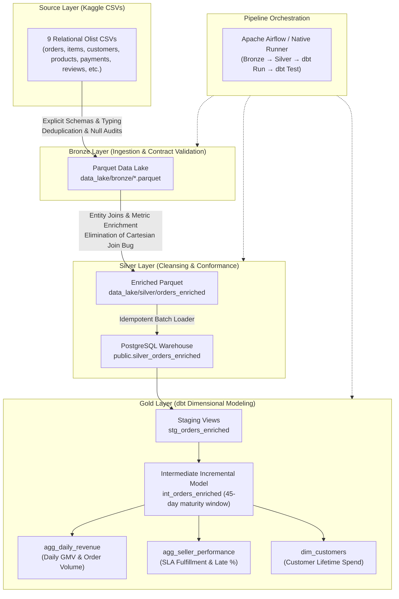

# DataStack — Olist Data Engineering Platform

[]()
[](https://www.python.org/)
[](https://spark.apache.org/)
[](https://www.getdbt.com/)
[](https://www.postgresql.org/)
[](LICENSE)

A production-style end-to-end data engineering platform built on the **Brazilian E-Commerce Public Dataset by Olist** (100k+ real commercial orders).

DataStack takes raw, semi-structured relational e-commerce transactions across 9 tables, enforces deterministic data contracts, executes cross-domain entity resolution, persists curated analytical layers in a PostgreSQL data warehouse, transforms business metrics using **dbt**, and orchestrates workflows with **Apache Airflow**.

---

## 🏛️ Medallion Architecture

DataStack implements a multi-layer Medallion Lakehouse & Warehouse architecture:



---

## 🛠️ Tech Stack & Tooling

| Component | Technology | Version | Engineering Role |
|---|---|---|---|
| **Data Processing Engine** | Apache Spark (PySpark) / DuckDB | 3.5.1 / 1.x | Scalable batch ETL, explicit schema casting, Parquet writing |
| **Data Warehouse** | PostgreSQL | 15+ | Relational OLAP warehouse for silver line items and gold marts |
| **Transformation Framework** | dbt-core & dbt-postgres | 1.11 | SQL modeling, incremental processing, documentation, schema contracts |
| **Pipeline Orchestrator** | Apache Airflow | 2.10+ | DAG dependency management, retries, idempotent execution |
| **Language & Environment** | Python & Conda / Temurin JDK | 3.12 / Java 11 | Strong typing, reproducible environment, cross-platform portability |
| **Infrastructure** | Docker & Docker Compose | Latest | Local containerized warehouse with health checks and volume persistence |

---

## 🔍 Key Engineering Improvements & Problem Solving

DataStack substantially refactors and advances the original upstream baseline ([`abaqasif-aa/olist_data_pipeline_end`](https://github.com/abaqasif-aa/olist_data_pipeline_end)):

### 1. Eliminated the Critical Cartesian Product / Revenue Multiplication Bug
- **The Upstream Flaw:** In the original pipeline, `order_items` (1:N) and `order_payments` (1:M) were directly left-joined on `order_id`. For orders with multiple items and multiple payment methods (e.g., gift card + credit card), this performed an $N \times M$ Cartesian product, multiplying recorded item prices, shipping freight, and overall revenue.
- **The DataStack Fix:** Disentangled the data grains. Aggregated payment totals to the order grain prior to joining with line items, preserving exact line item financial integrity and preventing revenue distortion.

### 2. Explicit Schemas vs Fragile Runtime Inference
- **The Upstream Flaw:** Upstream utilized `inferSchema=True` across all CSV reads, causing inconsistent typing across runs, silent failures on unexpected formatting, and extreme ingestion latency.
- **The DataStack Fix:** Enforced deterministic `StructType` schemas for all 9 Olist datasets, with automatic input validation and informative error messages.

### 3. Logistical Delivery SLA Metric Correctness
- **The Upstream Flaw:** Upstream dbt singular tests erroneously marked all negative `delivery_delay_days` as critical failures (`delivery_delay_days < 0`). In reality, early deliveries legitimately produce negative delay days.
- **The DataStack Fix:** Corrected delay calculations and test logic to validate against realistic logistics tolerances (`[-30, 365]` days), distinguishing early deliveries (`is_late = 0`) from delayed shipments (`is_late = 1`).

### 4. Cross-Platform Portability & Zero Hardcoded Secrets
- Upstream hardcoded machine paths (`/mnt/d/Practise Projects/...`, `C:/hadoop`), personal email addresses, and static credentials.
- DataStack introduces dynamic path resolution, environment variable management via `.env`, Docker Compose with isolated port bindings (5434), and automated native fallback execution.

---

## 📁 Repository Structure

```
Datastack/
├── .github/
│   └── workflows/ci.yml          # GitHub Actions CI for tests & linting
├── airflow/
│   └── dags/
│       └── olist_pipeline.py     # Production Airflow DAG
├── docker/
│   └── init-db.sql               # PostgreSQL schema initialization
├── docs/
│   ├── architecture.md           # Deep dive into pipeline architecture
│   ├── data_dictionary.md        # Complete schema specifications & metrics
│   ├── setup.md                  # Comprehensive installation & runtime guide
│   ├── testing.md                # QA strategy & test assertions
│   └── benchmark.md              # Methodology & performance benchmarks
├── olist_dbt/
│   ├── macros/
│   │   └── date_utils.sql        # Date extraction & formatting macros
│   ├── models/
│   │   ├── staging/
│   │   │   ├── stg_orders_enriched.sql
│   │   │   └── schema.yml
│   │   ├── intermediate/
│   │   │   └── int_orders_enriched.sql
│   │   └── marts/
│   │       ├── agg_daily_revenue.sql
│   │       ├── agg_seller_performance.sql
│   │       └── dim_customers.sql
│   ├── tests/
│   │   ├── assert_delivered_orders_have_payment.sql
│   │   ├── assert_delivery_delay_in_range.sql
│   │   └── assert_customers_have_spend.sql
│   └── dbt_project.yml
├── scripts/
│   ├── run_pipeline.py           # Automated local end-to-end pipeline runner
│   └── run_benchmark.py          # Benchmark comparing PySpark and DuckDB
├── src/datastack/
│   ├── config.py                 # Centralized configuration & settings
│   ├── schemas.py                # Explicit schemas for all 9 Olist tables
│   ├── ingest/
│   │   └── bronze.py             # CSV -> Parquet ingestion with deduplication
│   ├── transform/
│   │   └── silver.py             # Silver enrichment & PostgreSQL loader
│   └── warehouse/
│       └── postgres.py           # PostgreSQL health checks and DDL setup
├── tests/
│   ├── fixtures/*.csv            # Realistic synthetic fixtures covering edge cases
│   ├── test_schemas.py           # Schema contract unit tests
│   ├── test_joins.py             # Cardinality & financial integrity unit tests
│   ├── test_transformations.py   # Delivery SLA & metric tests
│   └── test_idempotency.py       # Recovery & rerun tests
├── .env.example                  # Safe configuration template
├── .gitignore                    # Comprehensive secrets & lake protection
├── docker-compose.yml            # Containerized PostgreSQL service
├── LICENSE                       # MIT License
├── NOTICE.md                     # Upstream attribution & license notices
├── pyproject.toml                # Package configuration
└── requirements.txt              # Production dependency specifications
```

---

## ⚡ Quick Start

### 1. Clone & Set Up Environment

```powershell
# Clone the repository
git clone https://github.com/VaishnavSreekumar/Datastack.git
cd Datastack

# Create conda environment (Python 3.12 + OpenJDK 11)
conda create -n datastack-env python=3.12 openjdk=11 -y
conda activate datastack-env

# Install dependencies and local package
pip install -r requirements.txt
pip install -e .
```

### 2. Configure Environment

```powershell
cp .env.example .env
```

### 3. Start Local Warehouse

```powershell
# Option A: Start containerized PostgreSQL via Docker Compose
docker compose up -d

# Option B: Or use an existing local PostgreSQL instance (port 5432)
```

### 4. Execute the End-to-End Pipeline

```powershell
python scripts/run_pipeline.py
```

### 5. Run the Test Suite

```powershell
pytest -v
```

### 6. Run the Performance Benchmark

```powershell
python scripts/run_benchmark.py
```

---

## 🧪 Testing & Verification

DataStack includes deterministic unit tests with synthetic fixtures covering critical edge cases:
- **Join Cardinality:** Proves that orders with multiple items and multiple payments generate exactly 1 row per order item and maintain reconciled revenue totals.
- **SLA Calculation:** Asserts correct signed delay values for early deliveries (`< 0`) and late deliveries (`> 0`).
- **Idempotency:** Validates that rerunning ingestion and transformation yields stable row counts and identical checksums.

---

## 📜 Attribution & License

- Original project: [olist_data_pipeline_end](https://github.com/abaqasif-aa/olist_data_pipeline_end) by Abaq Asif.
- Dataset: [Brazilian E-Commerce Public Dataset by Olist](https://www.kaggle.com/datasets/olistbr/brazilian-ecommerce) on Kaggle.
- Licensed under the [MIT License](LICENSE). Detailed third-party notices are documented in [NOTICE.md](NOTICE.md).
