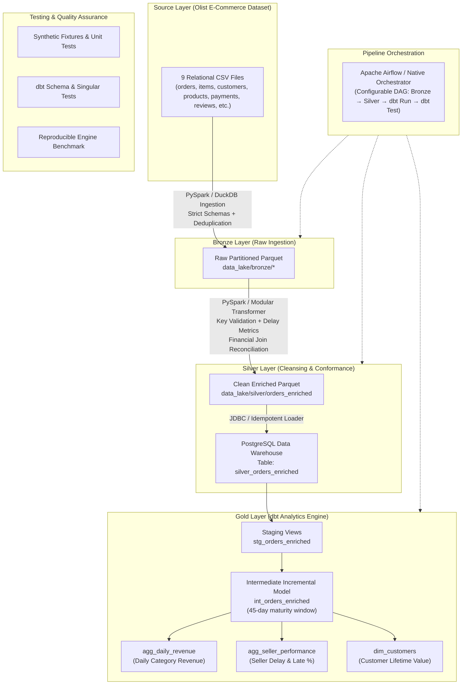

# DataStack Architecture

## 1. System Overview

DataStack is an end-to-end, production-oriented data engineering platform designed to ingest, process, transform, model, and serve the Brazilian E-Commerce Public Dataset by Olist (100k+ orders).

The architecture implements the **Medallion Architecture pattern** (Bronze, Silver, Gold), orchestrating raw batch files into clean, verified dimensional models for analytical consumption.

## 2. Layer Responsibilities

### Bronze Layer (Raw & Typed Storage)
- **Role:** Direct ingestion from external CSVs with deterministic schema enforcement.
- **Key Enhancements over Upstream:**
  - Upstream relied on fragile runtime schema inference (`inferSchema=True`). DataStack enforces explicit `StructType` schemas for all 9 source files.
  - Detects missing files gracefully without uncontrolled crashes.
  - Converts data types (timestamps, decimals, integers) accurately at source boundary.
  - Persists data to columnar Parquet format.

### Silver Layer (Cleansing, Conformance & Join Integrity)
- **Role:** Cross-table enrichment, data hygiene, and warehouse persistence.
- **The Cartesian Join Multiplier Fix:**
  - In the upstream implementation, a left join between `orders`, `order_items`, and `order_payments` caused a Cartesian product whenever an order contained multiple items ($N$) and multiple payments ($M$), inflating rows by $N \times M$ and multiplying recorded revenue.
  - DataStack fixes this by distinguishing grain: line items retain individual prices and freight, while order-level payment totals are aggregated prior to joining, or tracked at explicit grain levels without duplicating payment value.
- **Derived Metrics:**
  - `delivery_delay_days`: Signed difference between actual delivery date and estimated delivery date. (Early deliveries have negative delay values; late deliveries have positive delay values).
  - `is_late`: Deterministic binary flag (`1` if `delivery_delay_days > 0`, else `0`).
  - `total_item_value`: Item price + freight.

### Gold Layer (Dimensional Modeling via dbt)
- **Staging (`stg_orders_enriched`):** Clean view over the silver table, filtering invalid records and standardizing column identifiers.
- **Intermediate (`int_orders_enriched`):** Incremental table using `delete+insert` strategy with a 45-day maturity window to handle late-arriving order status updates without reprocessing full history.
- **Marts:**
  - `agg_daily_revenue`: Daily revenue and distinct order volume by product category.
  - `agg_seller_performance`: Fulfillment latency, delayed order rates, and seller volume.
  - `dim_customers`: Customer order frequencies, total spend, and lifetime spans.

## 3. Infrastructure & Deployment
- **Warehouse:** PostgreSQL 15+ containerized with Docker Compose or running on native local instances.
- **Orchestration:** Airflow DAGs with idempotent retries, zero hardcoded secrets, and no external unauthorized email alerts.
- **Portability:** Fully executable on Windows (PowerShell/Conda) and Linux/macOS environments.
