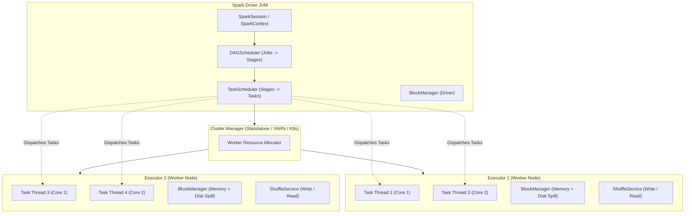
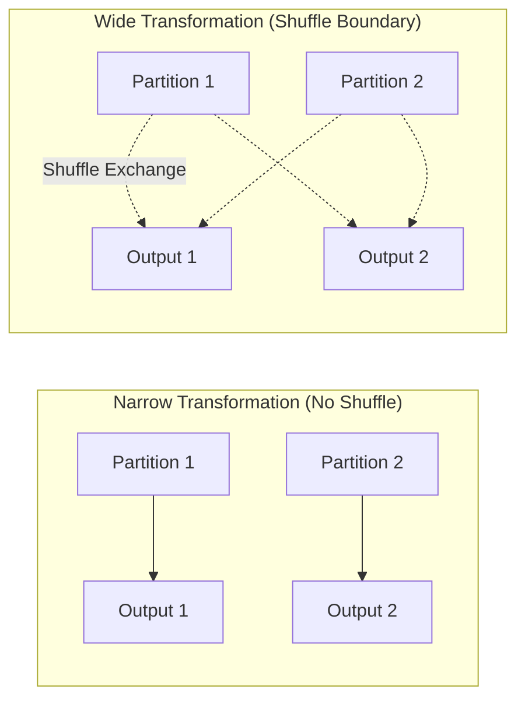

# Apache Spark Core Architecture & Fundamentals

A comprehensive technical reference for enterprise Spark engineering, distributed systems internals, query optimization, and execution mechanics.

---

## 1. RDD versus DataFrame: Abstraction Comparison

| Characteristic | Resilient Distributed Datasets (RDD) | Spark DataFrames |
|---|---|---|
| **Abstraction Level** | Low-level distributed object collection (`RDD[T]`). | High-level distributed table with named columns and schemas (`DataFrame = Dataset[Row]`). |
| **Optimization Engine** | None. User code executes as opaque Python/Java lambdas. | **Catalyst Optimizer** & **Tungsten Execution Engine**. |
| **Execution Speed** | Slower in Python due to Py4J socket and serialization overhead. | Near C-speed execution via Tungsten whole-stage code generation. |
| **Serialization** | Requires Python `cloudpickle` across JVM-Python boundary. | Stored in off-heap, compact binary columnar format (UnsafeRow). |
| **Schema & Types** | Unstructured or runtime object types; no compile-time schema. | Strict typed schema (`StructType`, `StructField`) with nullability rules. |
| **Best Used For** | Unstructured text, binary streams, custom graph algorithms. | Structured ETL, dimensional modeling, analytical aggregations, SQL workloads. |

### Why DataFrames Are Generally Preferred for Structured ETL
1. **Catalyst Optimization:** Spark automatically applies logical optimization rules:
   - *Predicate Pushdown:* Filters are evaluated directly at the data source before loading columns.
   - *Column Pruning:* Unused columns are discarded immediately.
   - *Constant Folding:* Computations like `1 + 1` are evaluated at plan compilation time.
2. **Tungsten Engine:** Generates optimized Java bytecode on the fly, eliminating virtual function dispatch and keeping intermediate data inside CPU L1/L2 caches.
3. **Cross-Language Parity:** A PySpark DataFrame runs the exact same optimized JVM physical plan as a Scala or SQL query, avoiding the Python worker serialization bottleneck.

---

## 2. Distributed Architecture: Driver vs Executors



### Driver Responsibilities
- **Application Orchestration:** Executes the `main()` function, initializes `SparkSession`.
- **DAG Construction:** Converts user transformations into a directed acyclic graph of logical operators.
- **Stage Decomposition:** `DAGScheduler` identifies shuffle boundaries and splits the DAG into stages.
- **Task Scheduling:** `TaskScheduler` serializes tasks and dispatches them to executors based on data locality (PROCESS_LOCAL, NODE_LOCAL, RACK_LOCAL).
- **Metadata Management:** Tracks broadcast variables, accumulator updates, and task execution states.

### Executor Responsibilities
- **Task Execution:** Runs worker threads executing serialized tasks dispatched by the driver.
- **Storage & Caching:** Houses the `BlockManager` for caching in-memory partitions or spilling to disk.
- **Shuffle Serving:** Manages shuffle write files and serves shuffle read requests to downstream tasks.

---

## 3. Execution Hierarchy: Jobs, Stages, and Tasks

- **Job:** Created whenever an **Action** (e.g. `count()`, `collect()`, `write.parquet()`) is called on a DataFrame or RDD.
- **Stage:** A Job is decomposed into multiple Stages. The boundaries between stages are defined by **Wide Transformations** (shuffle dependencies).
- **Task:** The smallest unit of execution in Spark. One Task is executed on one CPU core for **one partition** of data within a Stage. If a Stage has 200 partitions, Spark spawns 200 Tasks.

---

## 4. Lazy Evaluation, Transformations, and Actions

### Lazy Evaluation
Transformations in Spark are **strictly lazy**. Calling `select()`, `filter()`, `withColumn()`, `join()`, or `groupBy()` does **not** read data from disk or execute computations. Instead, it constructs a Catalyst logical plan tree.

**Why Lazy Evaluation Matters:**
- **Whole-Query Optimization:** Spark sees the entire transformation chain before running, allowing it to combine filters, prune unnecessary columns, and select the optimal join strategy (e.g., BroadcastHashJoin vs SortMergeJoin).
- **Fault Tolerance:** If an executor fails, Spark recomputes only the lost partitions using the DAG lineage rather than restarting the entire job.

### Transformations vs Actions
- **Transformations (Lazy):** Return a new DataFrame/RDD without executing computation.
  - Examples: `select()`, `filter()`, `withColumn()`, `groupBy()`, `join()`, `repartition()`, `coalesce()`.
- **Actions (Eager):** Force the execution of the DAG, triggering compilation, optimization, task scheduling, and data processing.
  - Examples: `count()`, `collect()`, `take(n)`, `first()`, `show()`, `write.save()`.

---

## 5. Narrow vs Wide Transformations & Shuffles



### Narrow Transformations (Pipelined, Zero Network Shuffle)
- Each input partition contributes to **at most one** output partition.
- Tasks execute locally within the same JVM thread without exchanging data over the network.
- Spark pipelines multiple narrow transformations together into a single Java method via `WholeStageCodegen`.
- *Examples:* `select()`, `filter()`, `withColumn()`, `map()`, `coalesce()`.

### Wide Transformations (Shuffle Boundary)
- Input partitions contribute to **multiple** output partitions based on a hash key or partitioner.
- Forces data to be serialized, sorted, written to disk, and transferred over the network/IPC.
- Creates a new Stage in the Spark execution plan.
- *Examples:* `groupBy()`, `join()`, `distinct()`, `repartition()`, `reduceByKey()`.

### Why Shuffles Are Expensive in Production
1. **Disk I/O Overhead:** Shuffle writes persist serialized intermediate files to local disk to ensure fault tolerance.
2. **Network Saturation:** Transferring partitions across cluster racks consumes network throughput.
3. **Data Skew & Stragglers:** If a key distribution is uneven, a single partition can become massive, causing one task to run for hours while others finish in seconds.
4. **Memory Pressure:** Hash aggregation and sort buffers consume JVM memory, causing GC pauses or disk spilling.

---

## 6. Partitioning Strategies: Repartition vs Coalesce

| Dimension | `repartition(n)` | `coalesce(n)` |
|---|---|---|
| **Transformation Type** | Wide Transformation (Full Shuffle). | Narrow Transformation (Zero Shuffle). |
| **Direction** | Can increase or decrease partition count. | Can **only decrease** partition count. |
| **Mechanism** | Redistributes data uniformly using round-robin or hash exchange. | Merges adjacent partitions residing on the same executor node. |
| **Physical Plan Operator** | `Exchange RoundRobinPartitioning` or `hashpartitioning`. | `Coalesce` operator without `Exchange`. |
| **Use Case** | Rebalancing skewed data or increasing parallelism before heavy joins. | Reducing partition count before writing output files to disk (eliminates small files). |

---

## 7. Spark SQL Execution Plans: The Catalyst Pipeline

When a DataFrame query executes, Catalyst moves through four progressive plan states:

```
Unresolved Logical Plan
       ↓  (Analysis using Catalog / Schema resolution)
Analyzed Logical Plan
       ↓  (Logical Optimization Rules: Predicate Pushdown, Column Pruning)
Optimized Logical Plan
       ↓  (Physical Planning: Join selection, Aggregate selection)
Physical Plan (Tungsten WholeStageCodegen & Adaptive Spark Plan)
```

1. **Parsed Logical Plan:** Raw Abstract Syntax Tree (AST) constructed from SQL or DataFrame API calls. Column names and types are unresolved.
2. **Analyzed Logical Plan:** The Catalog resolves table and column names, verifies schemas, and checks data types.
3. **Optimized Logical Plan:** Catalyst applies rule-based optimizations:
   - Pushes `Filter` below `Project` and into `FileScan`.
   - Prunes unused columns from table scans.
   - Simplifies arithmetic and boolean expressions.
4. **Physical Plan:** Selects concrete physical operators (e.g. `BroadcastHashJoin` vs `SortMergeJoin`, `HashAggregate` vs `SortAggregate`), assigns exchange strategies, and applies Tungsten `WholeStageCodegen`.

---

## 8. Inspecting Jobs, Stages, and Tasks

1. **Spark Web UI (Port 4040):**
   - **Jobs Tab:** View overall status, timeline, and actions that triggered execution.
   - **Stages Tab:** View DAG visualization, shuffle read/write bytes, spilled memory/disk bytes, and task duration percentiles (identifies data skew).
   - **Executors Tab:** Monitor active cores, GC time, memory usage, and task failure rates.
   - **SQL / DataFrame Tab:** Inspect interactive visual DAG of the Catalyst physical plan.
2. **Programmatic Query Execution:**
   - `df.explain(True)`: Prints Parsed, Analyzed, Optimized, and Physical plans directly to stdout.
   - `df._jdf.queryExecution().executedPlan()`: Returns the low-level JVM physical plan object.
3. **Event Logs:** Set `spark.eventLog.enabled=true` and `spark.eventLog.dir` to store JSON execution event logs for post-mortem analysis via the Spark History Server (Port 18080).
